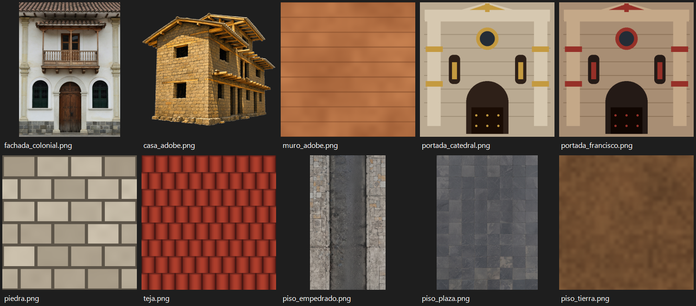

# Catálogo de fachadas y texturas — Calles de Cajamarca

Orden oficial del arte de calle del capítulo **CALLES**. Reúne las 8 texturas que
tienen material propio (`Ruta*`), las 2 texturas auxiliares, las fachadas
principales y el orden sugerido de calles para el pase de arte.

- **Fuente de texturas:** `Assets/Resources/Calle/`
- **Materiales:** `Assets/Generated/Cajamarca/Materials/Ruta*.mat`
- **Mallas del plano:** `Assets/Resources/Calle/PlanoCajamarca.fbx`
- **Calles registradas:** `Assets/Resources/Calle/calles.json` (25 tramos, 13 vías)
- **Contacto visual:** `docs/img/calle-contacto.png`

---

## 1. Set principal, en orden de material (0 → 7)

| # | Material | Textura | Tamaño | Peso | Repetición | Uso |
| --- | --- | --- | --- | --- | --- | --- |
| 0 | `RutaPiedra_0` | `piedra.png` | 512 × 512 | 32 KB | Repeat | Sillería: zócalos, fuente, cruz, `PlanoPiedra` |
| 1 | `RutaEmpedrado_1` | `piso_empedrado.png` | 768 × 1368 | 2.4 MB | Mirror en el plano | Calzada de todos los jirones y pasajes |
| 2 | `RutaPlaza_2` | `piso_plaza.png` | 768 × 1024 | 1.2 MB | Repeat | Plaza de Armas, bandas plaza–calle y veredas |
| 3 | `RutaAdobe_3` | `muro_adobe.png` | 512 × 512 | 60 KB | Repeat | Muros laterales, capillas, conventos y lotes |
| 4 | `RutaTeja_4` | `teja.png` | 512 × 512 | 14 KB | Repeat | Techos, aleros y campanarios |
| 5 | `RutaFachada_5` | `fachada_colonial.png` | 864 × 1152 | 1.5 MB | Repeat (1 teja = 4.2 m) | Frente de calle de las casas del plano |
| 6 | `RutaPortadaCatedral_6` | `portada_catedral.png` | 512 × 512 | 4 KB | Clamp | Portada de la Catedral |
| 7 | `RutaPortadaFrancisco_7` | `portada_francisco.png` | 512 × 512 | 4 KB | Clamp | Portada de San Francisco |

### Auxiliares (sin material `Ruta*`)

| Textura | Tamaño | Peso | Repetición | Uso |
| --- | --- | --- | --- | --- |
| `casa_adobe.png` | 1250 × 1064 | 3.0 MB | Clamp | Billboard `CasaAdobe` de `MonteDressing` (vista isométrica, no tesela) |
| `piso_tierra.png` | 512 × 512 | 120 KB | Repeat | Suelo de la ciudad de fondo (`CajamarcaRealRelieve`) y sendero del bosque |
| `piso_cesped.png` (`Bosque/`) | — | — | Repeat | Respaldo de `PlanoSuelo`, fuera de la calle |

> Los materiales `RutaJardin_8`, `RutaAgua_9` y `RutaTerreno_110` no llevan
> textura: se pintan con color plano.

---

## 2. Fachadas principales, ordenadas por jerarquía

| Prioridad | Fachada | Textura base | Complementos | Dónde se ve |
| --- | --- | --- | --- | --- |
| 1 | **Catedral de Cajamarca** | `portada_catedral.png` | `piedra` + `teja` | Malla `Catedral_de_Cajamarca_56` y `PlanoPortadaCatedral_real_relieve_6` |
| 2 | **Iglesia de San Francisco** | `portada_francisco.png` | `piedra` + `teja` | Malla `Iglesia_de_San_Francisco_57` y `PlanoPortadaFrancisco_real_relieve_7` |
| 3 | **Casona colonial (fachada tipo)** | `fachada_colonial.png` | `piedra` (zócalo) + `teja` (alero) | Frente de todas las casas del plano (`PlanoMuros`, `CasaFrente*`, `LotesFrentes`) |
| 4 | **Casa de adobe (referencia)** | `casa_adobe.png` | — | Billboard aislado en `MonteDressing`, x ≈ 89 |
| 5 | **Capillas y convento** | `muro_adobe.png` | `teja` + `piedra` (cruz) | `Capilla_Virgen_de_Fátima_59`, `Capilla_de_la_Virgen_de_los_Dolores_62`, `Convento_las_Carmelitas_58` |

Notas de uso:

- La **fachada tipo** está dibujada como un azulejo de una casa de **4.2 m** de
  ancho; la altura se normaliza (0 = vereda, 1 = alero), así sirve para casas de
  5 a 8 m sin repetir pisos.
- El plano reconstruye los muros sin vértices compartidos y aplica **7 tintes**
  por casa (`cal`, `salmón`, `crema`, `rosa colonial`, `rosa pálido`, `ocre`,
  `gris piedra`) al 40 % (`FacadeWash`). El relieve es el mismo; el color no.
- Los muros laterales de las casas y las capillas sí usan `muro_adobe`; el
  frente a calle usa `fachada_colonial`.
- El número de casas es alto (293 mallas `Casa_XXX`), pero **solo hay una
  fachada de calle y dos portadas**. Es el punto más repetitivo del set.

---

## 3. Suelos, ordenados por uso

| Uso | Textura | Comportamiento |
| --- | --- | --- |
| Calzada de jirones y pasajes | `piso_empedrado.png` | Es un corte transversal (calzada + cuneta + bordes) que se repite **en espejo** a lo largo de la vía; así no se nota la costura |
| Plaza de Armas y bandas plaza–calle | `piso_plaza.png` | Lajas grandes gris-azuladas, repetición normal |
| Veredas y bordes | `piso_plaza.png` + `piedra.png` | La vereda se dibuja con el piso de plaza y el borde con sillería |
| Terreno y cerros | `piso_tierra.png` | Tierra apisonada, solo en el fondo/relieve |
| Zócalos, fonte, cruz | `piedra.png` | Sillería caliza beige-crema |

---

## 4. Calles principales, orden sugerido para el pase de arte

Prioridad de arte: **P1** plaza y ejes monumentales · **P2** ejes comerciales ·
**P3** conexiones de barrio · **P4** pasajes peatonales. El ancho es el campo
`size` de `calles.json` (metros).

| Prioridad | Calle | Tramos | Ancho | Piso | Fachada |
| --- | --- | --- | --- | --- | --- |
| P1 | Jirón Dos de Mayo | 4 | 3.4 / 4.3 | `piso_empedrado` | `fachada_colonial` |
| P1 | Jirón Amalia Puga | 3 | 4.3 | `piso_empedrado` | `fachada_colonial` |
| P1 | Jirón Del Comercio | 2 | 4.3 | `piso_empedrado` | `fachada_colonial` |
| P1 | Jirón Cruz de Piedra | 1 | 4.3 | `piso_empedrado` | `fachada_colonial` |
| P2 | Jirón Amazonas | 3 | 4.3 | `piso_empedrado` | `fachada_colonial` |
| P2 | Jirón San Martín | 3 | 3.4 / 4.4 | `piso_empedrado` | `fachada_colonial` |
| P2 | Jirón Junín | 3 | 4.3 | `piso_empedrado` | `fachada_colonial` |
| P3 | Jirón Huánuco | 1 | 4.3 | `piso_empedrado` | `fachada_colonial` |
| P3 | Jirón del Batán | 1 | 4.3 | `piso_empedrado` | `fachada_colonial` |
| P3 | Jirón Petateros | 1 | 3.4 | `piso_empedrado` | `fachada_colonial` |
| P4 | Pasaje Atahualpa | 1 | 4.4 | `piso_empedrado` | `fachada_colonial` |
| P4 | Pasaje Colina Santa Apolonia | 1 | 4.3 | `piso_empedrado` | `fachada_colonial` |
| P4 | Pasaje de la Cultura | 1 | 4.4 | `piso_empedrado` | `fachada_colonial` |

**Total: 13 vías, 25 tramos.** La Catedral y San Francisco no se asignan a un
jirón: entran como mallas independientes con su propia portada.

---

## 5. Regla rápida para arte

1. Calle nueva → `piso_empedrado` en la calzada + `fachada_colonial` al frente.
2. Plaza o banda → `piso_plaza`.
3. Muro lateral, capilla o lote → `muro_adobe`.
4. Techo o alero → `teja`.
5. Portada de iglesia → `portada_*` con **Clamp**, nunca Repeat.
6. Zócalo, fuente o cruz → `piedra`.

---

## 6. Hallazgos y pendientes

1. **Una sola fachada de calle** para todo el casco: hay 7 tintes, pero el mismo
   balcón, arco y puerta. Conviene 3–4 variantes de relieve (con/sin balcón,
   uno/dos pisos, puerta lateral) y alternarlas por cuadra.
2. **Portadas de 512² y ~4 KB**: son planos de color casi sin detalle; la
   Catedral y San Francisco reales son piedra tallada. Subir a 1024/2048 o
   modelar el relieve antes del primer plano.
3. **`casa_adobe.png` no es teselable** (tiene fondo y perspectiva isométrica):
   solo vale como billboard. Falta una versión de muro de adobe con textura.
4. **Sin mapas de normal/rugosidad**: todo es albedo plano. Los adoquines, la
   teja y el adobe ganarían mucho con un normal map.
5. **`piso_tierra` no se usa en ninguna calle**: el casco siempre es empedrado.
   Si se quiere el borde rural de Cajamarca, hay que asignarlo a los senderos
   exteriores.
6. **Nombres**: `piso_empedrado` = calzada, `piso_plaza` = plaza/vereda,
   `piedra` = sillería. Mantener ese criterio al agregar texturas.

---

## 7. Investigación de la ciudad real

La lista de calles de este catálogo sale de `calles.json`. La comparación con el
centro histórico real (5 ejes fundacionales, 11 comerciales, 7 pasajes y 14
materiales) está en:

[`INVESTIGACION-CALLES-TEXTURAS-CAJAMARCA.md`](INVESTIGACION-CALLES-TEXTURAS-CAJAMARCA.md)

Faltan en el plano, entre otras: **Jirón Belén**, **Jirón Apurímac**,
**Tarapacá**, **La Mar**, **Pisagua**, **José Gálvez**, **Juan Villanueva**,
**Horacio Urteaga**, **Pasaje San Martín** y **Jirón Bambamarca**.
