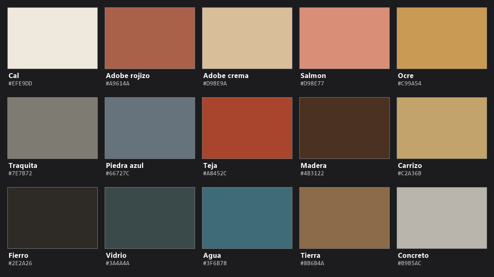

# Investigación: calles y texturas reales de Cajamarca

Investigación web para el arte del capítulo **CALLES**. Fecha: 2026-11-03.
Objetivo: separar lo que existe en el juego de lo que realmente tiene el centro
histórico de Cajamarca, y dejar una lista ordenada de calles y materiales.

- Calles del juego: `Assets/Resources/Calle/calles.json` (13 vías, 25 tramos)
- Texturas del juego: `Assets/Resources/Calle/`
- Catálogo técnico del juego: [`CATALOGO-CALLE-CAJAMARCA.md`](CATALOGO-CALLE-CAJAMARCA.md)

---

## 0. Resumen

- **5 ejes monumentales** (4 alrededor de la Plaza de Armas + Belén) concentran los monumentos.
- **11 ejes comerciales/conexión** forman la retícula del centro histórico.
- **7 pasajes y peatonales** incluyen los accesos al mirador y los pasajes de piedra azul.
- **14 materiales/texturas reales** definen la imagen de la ciudad; el juego solo tiene 8.
- El material dominante no es la piedra beige: es **adobe enlucido y encalado** con
  **portadas de traquita gris**, **piso de piedra azul** y **teja de arcilla**.

---

## 1. Calles principales

### 1.1 Ejes monumentales (prioridad P1)

| Calle | Orientación | Tramos | Hitos | Piso |
| --- | --- | --- | --- | --- |
| **Jirón Amalia Puga** | NO–SE | 11 cuadras | Plaza de Armas, Cuarto del Rescate (N.º 750), Convento de San Francisco, Concepcionistas, Plazuela Amalia Puga | Piedra azul / concreto |
| **Jirón Del Comercio** | NO–SE | 10 cuadras | Arco del Triunfo, Corte Superior, Plaza de Armas. Antes *Calle Real* y *Jirón Lima* | Piedra azul / concreto; tuvo acequia central |
| **Jirón Dos de Mayo** | SO–NE | 11 cuadras | Cerro Santa Apolonia, Plaza de Armas, Iglesia de San Francisco | Primeras 2 cuadras peatonales con escalinatas |
| **Jirón Cruz de Piedra** | SO–NE | ~630 m | Catedral (fachada a la plaza), Casona Espinach, Museo, Municipalidad | Piedra azul |
| **Jirón Belén** | SO–NE | 7 cuadras | Conjunto Monumental Belén (cuadras 4–5) | Piedra azul renovada en 2021 |

### 1.2 Ejes comerciales y de conexión (P2)

| Calle | Rol | Hitos / datos |
| --- | --- | --- |
| **Jirón Amazonas** | Comercial, une Belén con Dos de Mayo y Apurímac | Mercado, hoteles, comercio; eje de carga del centro |
| **Jirón Junín** | Comercial y de servicios | Colegio La Merced, Teatro; las cuadras 12–14 son la antigua *Calle de las Ánimas* |
| **Jirón San Martín** | Eje posterior a la plaza | Telefónica; la 3.ª cuadra es la antigua *Calle Angosta de los Aristizabal* |
| **Jirón Apurímac** | 12 cuadras, Av. Perú → Bambamarca | Teatro Cajamarca, Casona Uceda, Mercado Central y Modelo |
| **Jirón Huánuco** | Eje largo (~2 km de tramos en OSM) | Radio Doble N; cruza Belén, Amalia Puga y Dos de Mayo |
| **Jirón Tarapacá** | Comercial paralela | Conecta Apurímac, Comercio y Amalia Puga |
| **Jirón La Mar** | Comercial paralela | Entre Apurímac y Amalia Puga |
| **Jirón Pisagua** | Comercial paralela | Entre Apurímac y Comercio |
| **Jirón José Gálvez** | Comercial paralela | Entre Apurímac y Comercio |
| **Jirón Juan Villanueva** | Conexión noroeste | Entre Amalia Puga y Comercio |
| **Jirón Horacio Urteaga** | Conexión noroeste | Arranque de Amalia Puga, puente sobre el San Lucas |

### 1.3 Pasajes y peatonales (P3)

| Calle | Rol | Hitos / datos |
| --- | --- | --- |
| **Pasaje Atahualpa** | Peatonal / servicios | Biblioteca Municipal; antigua *Calle del Correo* |
| **Pasaje de la Cultura** | Peatonal institucional | Gobernación, Complejo Belén; piso de piedra azul |
| **Pasaje San Martín** | Peatonal | Piso de piedra azul renovado en 2021 |
| **Pasaje Colina Santa Apolonia** | Acceso al mirador | Subida larga (~650 m en OSM) |
| **Jirón del Batán** | Acceso al mirador | Museo Arqueológico Horacio Urteaga (N.º 289) |
| **Jirón Petateros** | Escalinatas | Conexión empinada hacia Belén / mirador |
| **Jirón Bambamarca** | Peatonal | Remate noreste de Apurímac |

### 1.4 Avenidas que enmarcan el centro (contexto, no casco)

`Avenida Perú`, `Avenida 13 de Julio`, `Avenida El Maestro`, `Avenida Héroes de
San Ramón`, `Avenida Mario Urteaga`, `Avenida Independencia`.

> OSM registra **196 calles con nombre** en un radio de 1 km de la Plaza. La
> lista de arriba es el núcleo patrimonial, no cada calle del distrito.

### 1.5 Lo que falta en `calles.json`

El juego modela 13 vías. Faltan del casco histórico:

`Jirón Belén`, `Jirón Apurímac`, `Jirón Tarapacá`, `Jirón La Mar`,
`Jirón Pisagua`, `Jirón José Gálvez`, `Jirón Juan Villanueva`,
`Jirón Horacio Urteaga`, `Jirón Ucayali`, `Jirón San Pablo`,
`Jirón Desamparados`, `Pasaje San Martín`, `Jirón Bambamarca`.

Prioridad para el pase de arte: **Belén y Apurímac** primero (tienen monumento y
mercado), luego Tarapacá/La Mar/Pisagua/Gálvez (retícula comercial) y al final
los pasajes.

---

## 2. Texturas reales

| # | Textura | Aspecto real | Dónde se usa | Hex aprox. | En el juego |
| --- | --- | --- | --- | --- | --- |
| 1 | **Adobe** | Bloque de tierra cruda con paja, superficie irregular, rojizo | Muros de casas, capillas, conventos | `#A9614A` | `muro_adobe.png` (naranja uniforme) |
| 2 | **Enlucido de barro** | Liso, mate, marrón claro | Revoque de muros de adobe | `#C9A87E` | No existe |
| 3 | **Cal / yeso** | Blanco marfil, liso | Fachadas encaladas, interiores | `#EFE9DD` | Solo como tinte de fachada |
| 4 | **Traquita** | Gris volcánico, porosa, rugosa | Portadas, zócalos, arcos, escaleras, bases de columnas | `#7E7B72` | `piedra.png` (beige caliza) |
| 5 | **Piedra azul** | Caliza azul-gris en lajas | Plaza, veredas, zaguanes, pasajes | `#66727C` | `piso_plaza.png` (cercano) |
| 6 | **Canto rodado** | Guijarros redondeados gris-marrón | Patios y atrios | `#8A8175` | No existe |
| 7 | **Teja de arcilla** | Rojo-naranja, curva, cocida | Cubiertas a 2 o 4 aguas | `#A8452C` | `teja.png` |
| 8 | **Madera** | Marrón oscuro, veta marcada | Puertas, ventanas, balcones, columnas, escaleras | `#4B3122` | No existe (solo color) |
| 9 | **Carrizo / caña** | Beige, listones paralelos | Debajo de la teja | `#C2A36B` | No existe |
| 10 | **Fierro forjado** | Negro, delgado | Rejas y balcones republicanos | `#2E2A26` | No existe |
| 11 | **Vidrio** | Verde-azul oscuro | Ventanas y puertas | `#3A4A4A` | Solo color plano |
| 12 | **Agua** | Verde-azul turbio | Acequias históricas y pileta | `#3F6B78` | Solo color plano |
| 13 | **Tapial** | Tierra apisonada con hiladas de piedra | Muros vernáculos | `#8B6B4A` | No existe |
| 14 | **Concreto / adoquín** | Gris claro, losas | Calzadas modernas | `#B9B5AC` | No existe |

### 2.1 Materiales y medidas para modelar

- **Adobe:** muros de **0.60–0.85 m** de espesor; dos niveles. Planta baja
  **3.50–5.50 m**, segundo nivel/terrado **~4.00 m**, total **7.50–9.50 m** con
  cubierta. Tierra arcillosa + paja + agua; mortero y enlucido del mismo barro;
  luego cal o yeso y pintura.
- **Portadas:** piedra (traquita) en su mayoría; barro o ladrillo en menor
  cantidad. Marco de piedra alrededor del vano, a veces escudo nobiliario.
  Inspiradas en la arquitectura religiosa.
- **Zócalo:** piedra natural tallada, trama desplazada; en una casona medida
  **1.20 m de alto × 0.10 m de profundidad**.
- **Cubierta:** estructura de madera + caña/carrizo + torta de barro + teja de
  arcilla; inclinación **25–30 %**; aleros amplios por la lluvia.
- **Pisos:** canto rodado y lajas de caliza “piedra azul” en zaguanes, patios y
  veredas; ladrillo de arcilla en salas y dormitorios.
- **Madera:** cedro para columnas y escaleras; capulí para umbrales; nogal para
  carpintería; balcones de balaustres.
- **Cal:** de yacimientos en los caminos a Otuzco y La Encañada.
- **Piedra volcánica (traquita):** de Huambocancha Alta, Pariamarca y la salida a
  la costa.
- **Piedra azul:** caliza de Pariamarca y Celendín.

### 2.2 Paleta aproximada

| Color | Hex | Uso |
| --- | --- | --- |
| Cal | `#EFE9DD` | Muros encalados |
| Adobe rojizo | `#A9614A` | Muro sin enlucir |
| Adobe crema | `#D9BE9A` | Enlucido |
| Salmón | `#D98E77` | Tinte de fachada |
| Ocre | `#C99A54` | Tinte de fachada |
| Traquita | `#7E7B72` | Portadas y zócalos |
| Piedra azul | `#66727C` | Pisos |
| Teja | `#A8452C` | Cubiertas |
| Madera | `#4B3122` | Puertas y balcones |
| Carrizo | `#C2A36B` | Bajo teja |
| Agua | `#3F6B78` | Acequias y pileta |
| Tierra | `#8B6B4A` | Tapial / terreno |

> Los hex son una guía de albedo, no una medición de laboratorio: la piedra y el
> adobe cambian mucho con la humedad y la hora del día.

---

## 3. Cómo se ve una calle real (de fachada a calzada)

De abajo hacia arriba, el perfil típico de una calle del casco:

1. **Calzada** de lajas de piedra azul o concreto/adoquín según la cuadra.
2. **Cuneta** de piedra y, en el casco antiguo, **acequia central** (documentada
   en el Comercio en 1880 y en Cruz de Piedra en 1932; hoy desaparecida).
3. **Vereda** de lajas de piedra azul con borde de sillería.
4. **Zócalo** de traquita, ~1.20 m.
5. **Muro** de adobe enlucido y encalado (blanco, crema, salmón, ocre, rosa).
6. **Portada** de piedra tallada con arco de medio punto y escudo.
7. **Vanos**: puerta de madera oscura, ventanas con reja, balcón de balaustres.
8. **Alero** de teja de arcilla sobre canes de madera.

Ese perfil es exactamente lo que la textura `fachada_colonial.png` intenta
resumir; el juego ya acierta en el balcón, el arco y el alero, pero le falta la
**portada de piedra gris** (la actual es blanca) y la **viga de madera**.

---

## 4. Comparación con los assets del juego

| Real | Asset actual | Brecha |
| --- | --- | --- |
| Adobe rojizo con paja | `muro_adobe.png` naranja plano | Demasiado saturado y uniforme; falta paja y manchas |
| Cal / enlucido | `fachada_colonial.png` + 7 tintes | Correcto en color; una sola geometría de fachada |
| Traquita gris | `piedra.png` beige | Color equivocado: la piedra local es gris volcánica |
| Piedra azul | `piso_plaza.png` gris-azul | Buen color; falta formato laja grande |
| Calzada de piedra azul | `piso_empedrado.png` | Es un corte transversal con cuneta central: sirve para calle histórica, no para vereda |
| Teja de arcilla | `teja.png` | Correcto; falta normal/rugosidad |
| Madera tallada | Solo color marrón | Falta textura de veta para puertas y balcones |
| Fierro forjado | No existe | Falta para rejas y balcones republicanos |
| Vidrio | Color plano | Falta reflejo/tono |
| Carrizo / caña | No existe | Solo se ve en aleros muy de cerca |
| Canto rodado | No existe | Faltan patios y atrios |
| Acequia central | Solo plano de agua | Falta variante de calle con acequia |
| Concreto / adoquín | No existe | Faltan las cuadras modernas |

---

## 5. Recomendaciones concretas

1. **Recolorear `piedra.png` a traquita gris** (`#7E7B72`) y crear una
   `piedra_azul.png` aparte para pisos.
2. **Crear 3 pisos de calle:** `piso_piedra_azul` (lajas), `piso_empedrado`
   (canto rodado, para cuadras laterales) y `piso_concreto` (cuadras modernas).
3. **Agregar textura de madera** para puertas, ventanas, balcones y aleros.
4. **Agregar reja de fierro** y **vidrio** como materiales simples.
5. **Variantes de fachada:** portada de piedra gris, balcón sí/no, uno/dos
   pisos; alternar por cuadra para romper la repetición de 293 casas.
6. **Variante de acequia central** para el tramo histórico de Del Comercio y
   Cruz de Piedra.
7. **Completar el plano** con Belén, Apurímac y la retícula Tarapacá–La Mar–
   Pisagua–Gálvez antes de los pasajes.
8. **Subir las portadas** de 512² a 1024/2048 y pasar de plano pintado a relieve
   de piedra volcánica.

---

## 6. Fuentes consultadas

- Wikipedia, *Centro histórico de Cajamarca*: https://es.wikipedia.org/wiki/Centro_hist%C3%B3rico_de_Cajamarca
- Wikipedia, *Jirón Amalia Puga*: https://es.wikipedia.org/wiki/Jir%C3%B3n_Amalia_Puga
- Wikipedia, *Jirón del Comercio*: https://es.wikipedia.org/wiki/Jir%C3%B3n_del_Comercio
- Wikipedia, *Jirón Dos de Mayo (Cajamarca)*: https://es.wikipedia.org/wiki/Jir%C3%B3n_Dos_de_Mayo_(Cajamarca)
- Wikipedia, *Jirón Belén*: https://es.wikipedia.org/wiki/Jir%C3%B3n_Bel%C3%A9n
- Wikipedia, *Jirón Apurímac (Cajamarca)*: https://es.wikipedia.org/wiki/Jir%C3%B3n_Apur%C3%ADmac_(Cajamarca)
- Municipalidad Provincial de Cajamarca, *Descubre Cajamarca — Centro histórico* (2026): https://www.gob.pe/25839-descubre-cajamarca-centro-historico-arquitectura-arqueologia-y-cultura
- Municipalidad Provincial de Cajamarca, *Mejoramiento del centro histórico* (2021): https://www.gob.pe/institucion/municajamarca/noticias/592080
- Municipalidad Provincial de Cajamarca, *Trabaja Perú para el centro histórico* (2021): https://www.gob.pe/institucion/municajamarca/noticias/592132
- Scaletti, A., *La arquitectura doméstica del centro histórico de Cajamarca* (2013): http://hdl.handle.net/10433/7429
- Urteaga Flores, K., *Arquitectura y diseño — Casa Cajamarquina* (repositorio UPN): https://repositorio.upn.edu.pe/backend/api/core/bitstreams/e20e5531-199c-47f7-8bfc-fdb7c46984f9/content
- *San Miguel de Pallaques — Arquitectura patrimonial cajamarquina: material y procedencia* (2019): http://sanmiguelcajamarca.blogspot.com/2019/07/arquitectura-patrimonial-cajamarquina.html
- Ministerio de Cultura, *Centro Histórico de Cajamarca — Lista Indicativa UNESCO*: https://patrimoniomundial.cultura.pe/listaindicativa/centro-hist%C3%B3rico-de-cajamarca
- La Rotativa, *21 fotos de Cajamarca* (2016; piedra azul y acequia central): https://larotativa.pe/21-fotos-de-cajamarca-que-te-haran-retroceder-en-el-tiempo/
- OpenStreetMap / Overpass API, consulta de vías con nombre en 1 km alrededor de la Plaza (2026-11-03).

---

## 7. Referencias visuales (Wikimedia Commons)

Para el pase de arte conviene mirar fotos reales antes de pintar. Estas son de
licencia libre; revisar la licencia de cada archivo antes de usarlo en el juego.

| Tema | Enlace |
| --- | --- |
| Plaza de Armas | https://commons.wikimedia.org/wiki/File:Plaza_de_Armas_de_Cajamarca_03.jpg |
| Plaza de Armas (otra) | https://commons.wikimedia.org/wiki/File:Plaza_de_Armas_de_Cajamarca_1.jpg |
| Catedral desde la plaza | https://commons.wikimedia.org/wiki/File:Catedral_de_Cajamarca_des_de_la_Plaza_de_Armas.jpg |
| Catedral (detalle) | https://commons.wikimedia.org/wiki/File:CATEDRAL_DE_CAJAMARCA_08.jpg |
| San Francisco desde la plaza | https://commons.wikimedia.org/wiki/File:San_Francisco_de_Asis_(Cajamarca)_des_de_la_Plaza_de_Armas.jpg |
| San Francisco (fachada secundaria) | https://commons.wikimedia.org/wiki/File:Fa%C3%A7ana_secund%C3%A0ria_del_convent_de_San_Francisco_de_Asis_(Cajamarca).jpg |
| Iglesia de Belén | https://commons.wikimedia.org/wiki/File:Iglesia_de_Bel%C3%A9n_de_Cajamarca_de_nit03.jpg |
| Escalinatas hacia Belén | https://commons.wikimedia.org/wiki/File:Cajamarca_steps.JPG |

---

## 8. Paquete de referencias descargado (2026-11-03)

Se descargaron **60 fotos** y **9 muestras de material** desde Wikimedia Commons
(CC BY-SA) a `docs/referencias/cajamarca/`, fuera de `Assets/`:

- `fachadas/` (16): casona del Conde de Uceda, casona de la antigua
  municipalidad, fachada del Jr. 2 de Mayo, portadas de piedra y puertas.
- `calles/` (23): Jr. 2 de Mayo, Amalia Puga, Eten, América, Atahualpa,
  Cinco Esquinas, Silva Santisteban, del Comercio, plazuela Amalia Puga,
  esquinas y una calle rural de tierra.
- `monumentos/` (17): Catedral, San Francisco, Belén, La Recoleta,
  Cuarto del Rescate, piletas y Plaza de Armas.
- `materiales/` (4) y `muestras/` (9 recortes): cal blanca y ocre,
  revoco desgastado, cantería de Belén, piedra inca, piedra azul, empedrado,
  teja y madera de puerta.

Detalle de autores, licencias y enlaces: `docs/referencias/CREDITOS.md`.
Guía de uso, paleta medida y cobertura por calle: `docs/referencias/README.md`.
Contactos: `docs/img/ref-fachadas.png`, `ref-calles.png`,
`ref-monumentos.png`, `ref-materiales.png`, `ref-muestras.png`.

Paleta medida de las muestras (hex): cal `#BFBFB7`, ocre `#9E8856`,
revoco `#9F9A88`, cantería `#878782`, piedra inca `#C6BFB3`,
piedra azul `#554F53`, empedrado `#65615E`, teja `#A68C7C`,
madera `#4C3931`.

Ninguna imagen se movió ni renombró dentro de `Assets/`; los `Ruta*.png` y
`Resources.Load("Calle/...")` siguen intactos.
